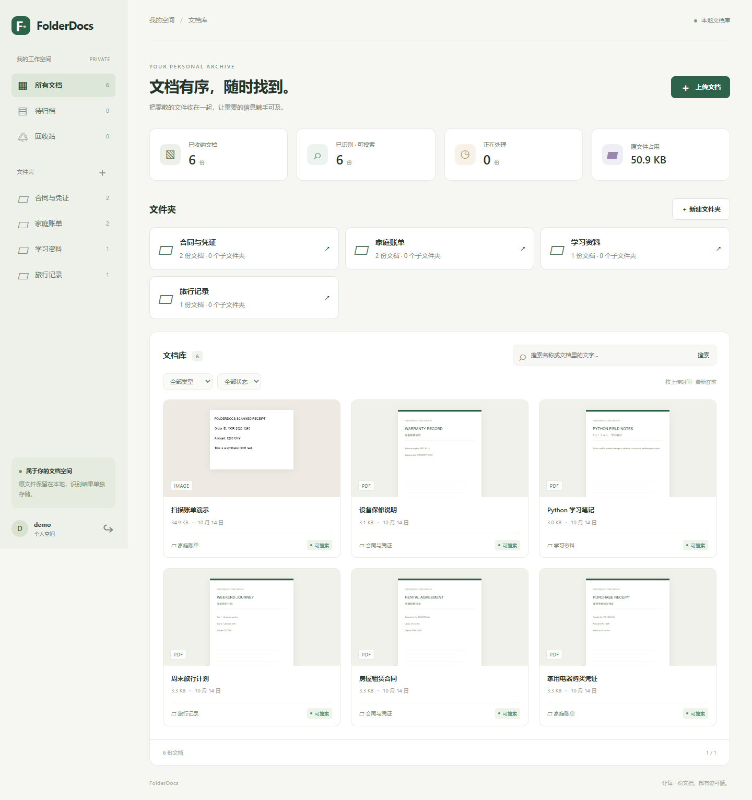
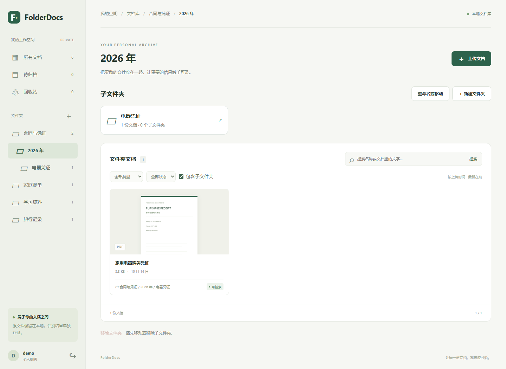

# FolderDocs

面向家庭与小团队的本地文档库。用熟悉的文件夹收纳 PDF、图片和文本，自动提取文字并搜索内容。主要实现语言是 **Python**，第一版优先支持 **Windows 原生运行**。



## 从真实需求出发

需求来源：[Is there an “Immich for documents”?](https://www.reddit.com/r/selfhosted/comments/1sdx0jn/is_there_an_immich_for_documents/)，2026-04-06。用户希望获得易用的文件夹操作、OCR 搜索、多用户私有空间，并尽量保持原始文件不变。

这是独立开发的第一版实现，与原帖作者没有合作或背书关系。需求帖用于指导选题，尚未完成用户访谈或商业验证。

## 当前功能

- 注册、登录、退出；每位用户有独立的文档与文件夹。
- 批量上传 PDF、PNG、JPG、WEBP 和 UTF-8 TXT；重复内容提示。
- 文档标题修改、文件夹归档、类型与处理状态筛选、分页。
- 多级文件夹（最多 8 层）、重命名、整体移动、面包屑导航和包含子目录的搜索。
- 有文字层的 PDF 直接提取；扫描 PDF 和图片通过 Tesseract OCR 识别。
- 后台队列、任务状态、失败后重试、中断任务恢复。
- 文件名和识别文字关键词搜索，展示匹配位置附近的摘要。
- 原文件预览与下载、首页缩略图；原文件不会因 OCR 而被修改。
- 回收站、恢复、永久删除；文件占用时提示重试。
- 响应式中文界面；静态资源全部本地加载。

## Windows 快速启动

需要 Python 3.12 或以上版本。以下命令在项目根目录的 PowerShell 中执行。

```powershell
powershell -NoProfile -ExecutionPolicy Bypass -File .\scripts\setup.ps1
powershell -NoProfile -ExecutionPolicy Bypass -File .\scripts\start.ps1
```

打开 **http://127.0.0.1:8765**，点击“创建账户”。完成首次安装后，也可以双击 `Start-FolderDocs.cmd`。启动脚本同时运行网页服务和后台处理进程；Ctrl+C 停止服务。默认仅监听本机回环地址。

指定端口：

```powershell
powershell -NoProfile -ExecutionPolicy Bypass -File .\scripts\start.ps1 -Port 8766
```

### 安装 OCR

文字型 PDF 和 TXT 不需要 OCR 引擎。图片和扫描 PDF 需要 Tesseract；缺少引擎时任务会显示失败原因，安装后可点击“重新处理”。

已有 Conda 时，可在项目内安装独立 OCR 环境，无需更改 Python 虚拟环境：

```powershell
powershell -NoProfile -ExecutionPolicy Bypass -File .\scripts\setup-ocr.ps1
# 若 conda 不在 PATH 中：
powershell -NoProfile -ExecutionPolicy Bypass -File .\scripts\setup-ocr.ps1 -CondaCommand 'D:\anaconda3\Scripts\conda.exe'
```

程序自动检测 `.tools/ocr/Library/bin/tesseract.exe`，并选择可用的简体中文与英语语言包。也支持 [Tesseract 文档推荐的 Windows 安装包](https://tesseract-ocr.github.io/tessdoc/Installation.html)；安装 `eng` 和 `chi_sim` 后配置：

```powershell
$env:TESSERACT_CMD = 'C:\Program Files\Tesseract-OCR\tesseract.exe'
$env:TESSDATA_PREFIX = 'C:\Program Files\Tesseract-OCR\tessdata'
.\scripts\start.ps1
```

这些环境变量需在启动网页和 worker 的同一个终端中设置。若简体中文语言包未安装，英语模型无法保证中文识别质量。

### 按层级整理文档

在文件夹页面点击“新建文件夹”，默认在当前目录下创建；也可在窗口中选择其他上级目录。通过“重命名或移动”可以调整目录及其全部子目录，同一位置的名称必须唯一。上传和文档归档的下拉菜单显示完整路径，方便区分不同位置的同名目录。

文件夹页面默认只显示当前目录的文档；勾选“包含子文件夹”后，搜索、类型筛选和分页会覆盖整棵子目录。面包屑和子文件夹卡片支持在手机上逐级浏览。



只能移除没有子文件夹的目录。文档（包括回收站中的文档）会保留在上级目录；移除顶层目录时归入“待归档”。重命名和移动只更新数据库中的归档关系，原文件不会改名或迁移。

从旧版升级时，先停止服务并备份完整数据目录。启动脚本会自动迁移数据库，已有文件夹保留为顶层目录。使用同名子目录后，不能直接退回旧版的单层目录数据库结构。

### 演示资料

```powershell
.\.venv\Scripts\python.exe manage.py seed_demo
.\.venv\Scripts\python.exe manage.py worker --drain
```

命令会创建 `demo` 账户及 6 份虚构文档，随机密码显示在终端；不会修改已有账户。重复运行时使用 `--username demo2` 等不同名称。所有截图仅使用这些演示文档。

## 开发与测试

PR 审查规则见 [AGENTS.md](AGENTS.md)，自动审查配置与完整审查提示词见 [PR 审查助手](docs/PR_REVIEW.md)。

```powershell
.\.venv\Scripts\python.exe manage.py check
.\.venv\Scripts\python.exe manage.py makemigrations --check --dry-run
.\.venv\Scripts\python.exe manage.py test
```

手动分开运行：

```powershell
.\.venv\Scripts\python.exe manage.py worker
# 另一个终端：
.\.venv\Scripts\python.exe manage.py runserver 127.0.0.1:8765
```

开发服务器需要 `$env:DJANGO_DEBUG='1'` 才会自动提供静态资源。日常使用建议采用启动脚本提供的 Waitress 服务。

CI 配置会在 Windows / Ubuntu、Python 3.12 / 3.14 上运行功能测试。普通测试用替代 OCR 调用验证错误重试；本机安装 Tesseract 后还可运行真实 OCR 集成测试：

```powershell
$env:FOLDERDOCS_TEST_OCR = '1'
.\.venv\Scripts\python.exe manage.py test
```

浏览器回归检查仅使用虚构资料。先安装 Playwright（`npm install --no-save playwright`，或通过 `NODE_PATH` 使用已有安装）；Windows 默认使用已安装的 Edge，可设置 `PLAYWRIGHT_CHANNEL` 选择其他已安装的浏览器。

```powershell
# 新建独立测试数据目录，避免修改个人文档；下面的终端使用相同环境变量。
$env:FOLDERDOCS_DATA_DIR = "$PWD\qa-output\browser-data"
$env:FOLDERDOCS_TEST_ACCOUNT = "$env:FOLDERDOCS_DATA_DIR\account.json"
$env:FOLDERDOCS_TEST_URL = 'http://127.0.0.1:8766'
.\.venv\Scripts\python.exe manage.py migrate --noinput
.\.venv\Scripts\python.exe qa\prepare_demo.py
.\scripts\start.ps1 -Port 8766
# 在另一个配置相同环境变量的终端：
node qa\browser.cjs
node qa\folders.cjs
```

检查覆盖上传、识别、下载、回收站，以及多级目录创建、移动、递归搜索、文件内容保留和手机导航；截图写入 `docs/screenshots/`，账号密码留在被忽略的 `qa-output/` 中。

## 结构与数据

```text
folderdocs/       Django 配置与路由
documents/        数据模型、页面处理、后台任务和测试
templates/        Django 页面模板
static/           本地 CSS 与少量交互 JavaScript
scripts/          Windows 安装、启动与 OCR 脚本
data/             SQLite 数据库、密钥、原文件、预览图（不提交 Git）
```

后端采用 Django 5.2、SQLite、Waitress；OCR 通过 pytesseract 调用 Tesseract；PDF 处理与渲染采用 PyMuPDF。数据库保存文字、元数据和任务队列，原始文件按用户和随机文档 ID 存放。文档和缩略图都经身份校验的路由读取，不暴露公开 media 目录。

后台 worker 使用条件更新抢占任务并记录任务令牌；过期两小时的处理中任务会恢复到队列。SQLite 版推荐只启动一个 worker。默认搜索为正文子串匹配，适合个人或小团队文档库；大规模文档索引列入后续计划。

`FOLDERDOCS_DATA_DIR` 可指定数据目录；请将 SQLite 数据库放在可靠的本地磁盘上，NFS/SMB 文件原位索引尚未实现。备份时停止两个进程，复制整个 `data/` 目录，恢复后按原配置启动即可。

## 第一版边界与后续计划

当前限制：每次 1–20 个文件、单个文件 25 MB、PDF 最多 100 页；扫描页仅对前 30 页执行 OCR（其余页会提示未识别），文字型页面仍提取全文。文件夹最多 8 层，每个名称最多 80 个字符。数据库中的文字保存最多 200 万字符。

- [x] 多级文件夹、重命名与整体移动。
- [ ] 共享文件夹。
- [ ] 有效期分享链接、撤销分享与邀请注册。
- [ ] NAS 原位扫描及增量索引。
- [ ] PostgreSQL 与专业全文检索。
- [ ] 自动备份恢复、Docker Compose。

第一版默认开放本机注册。若以后部署到公网，先完成邀请注册、登录限流、HTTPS 和服务部署配置；不要直接把默认本机服务开放到互联网。

## 许可证

GNU AGPL-3.0，见 [LICENSE](LICENSE)。运行时依赖保留各自的许可证；OCR 安装目录和第三方二进制不随源码仓库分发。
